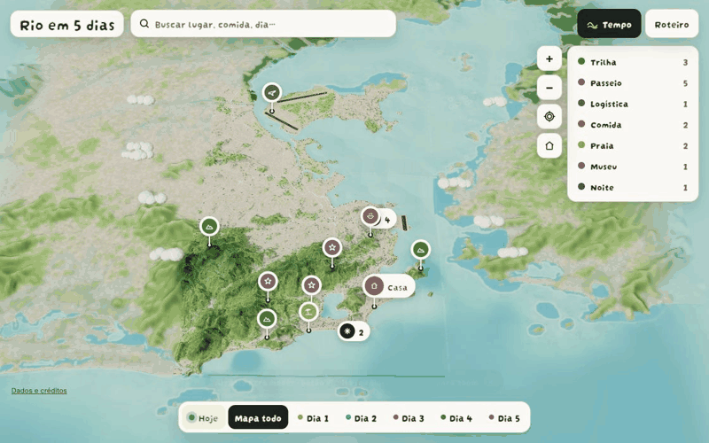
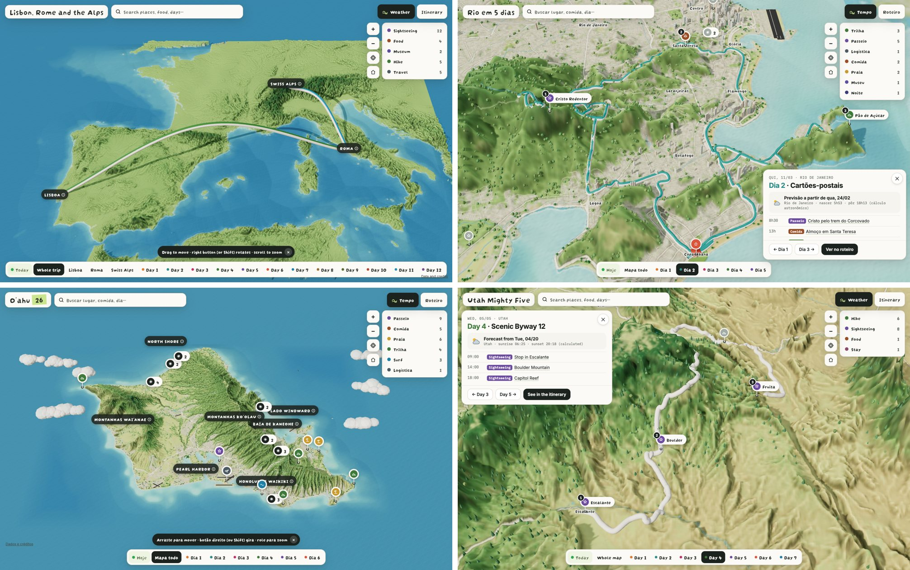
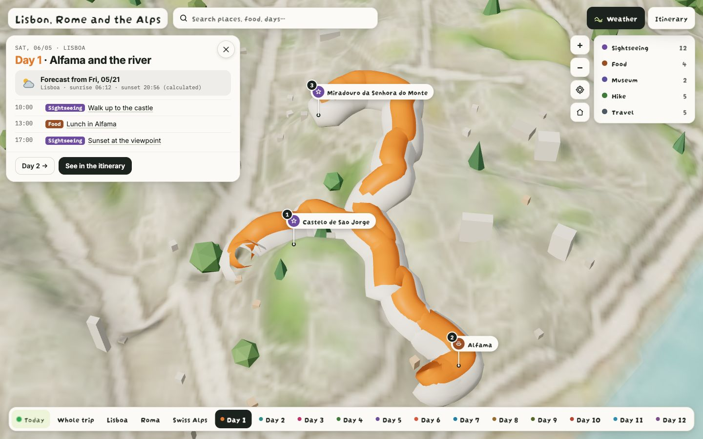
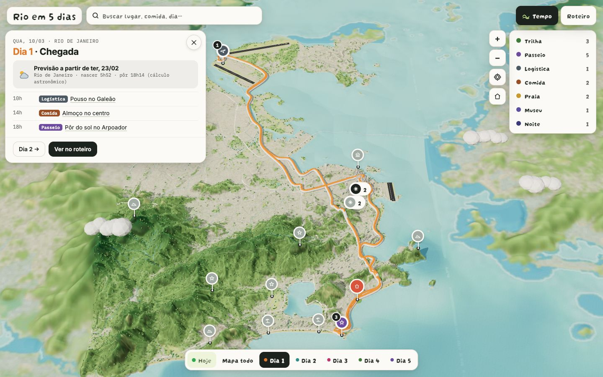
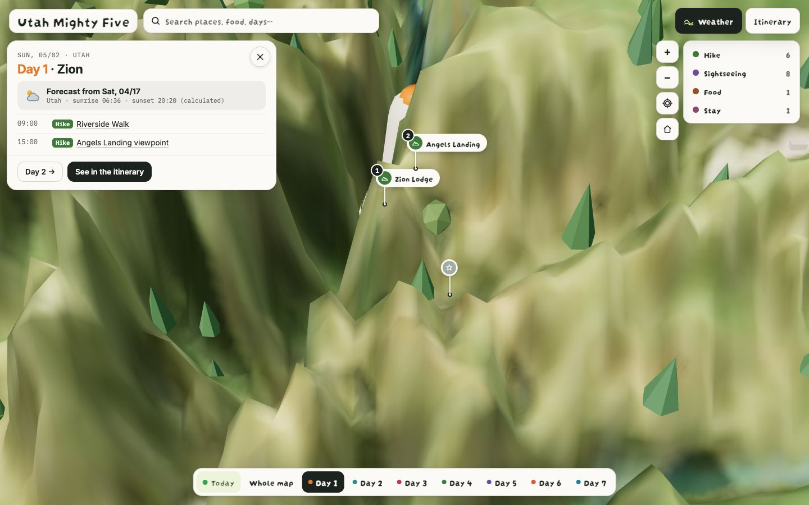
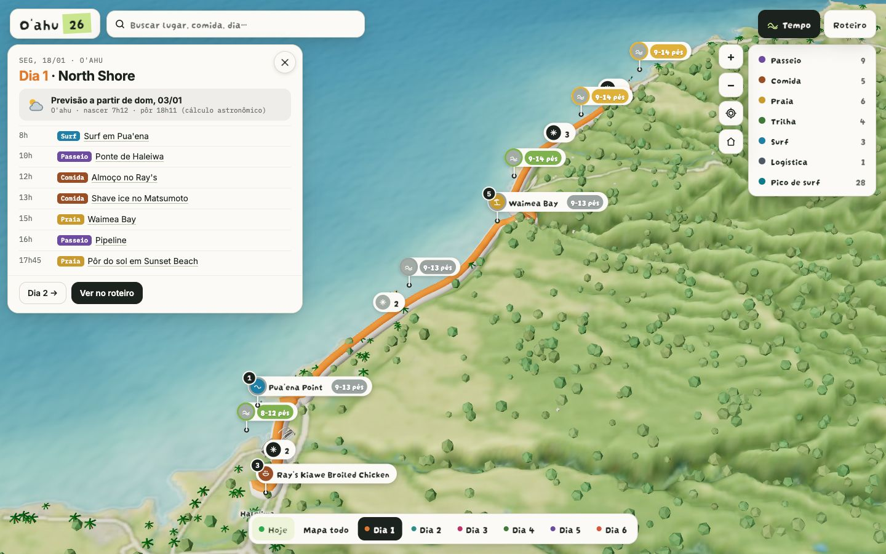
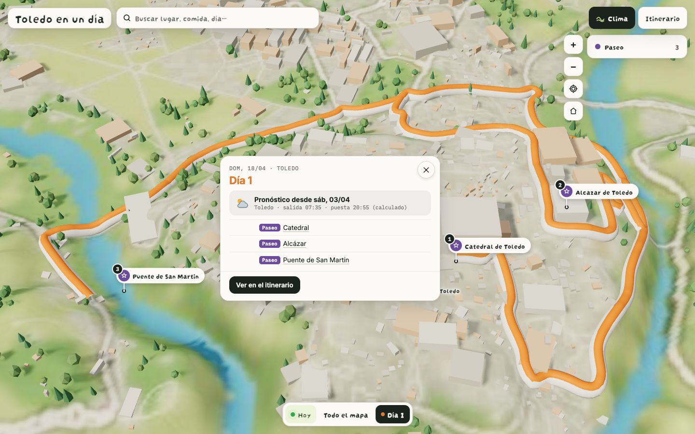
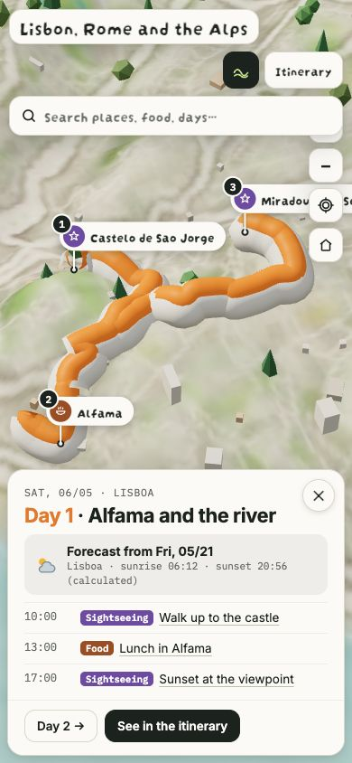

<div align="center">

# trip-map-3d

**Décrivez votre voyage dans un seul fichier. Faites un push. Obtenez un site avec une vraie carte 3D, partout dans le monde.**

[](../../LICENSE)
[](https://github.com/orodmorais/trip-map-3d/actions/workflows/deploy.yml)


[English](../../README.md) · [Português](README.pt-BR.md) · [Español](README.es.md) · [Italiano](README.it.md) · **Français** · [Deutsch](README.de.md) · [简体中文](README.zh-CN.md) · [日本語](README.ja.md) · [한국어](README.ko.md)

> Ceci est une traduction. En cas de différence avec le [README en anglais](../../README.md), c'est la version anglaise qui fait foi. Le site généré est disponible en anglais, en portugais et en espagnol.





</div>

Je voulais préparer un voyage avec quelque chose que je pouvais vraiment voir. Sur une carte plate, un petit trajet en voiture et un sentier raide se ressemblent. En 3D, on voit la crête avant de se lancer dans la rando, et on comprend vraiment quelle part de la journée (et du réservoir) un itinéraire va prendre.

Alors je l'ai construit pour mon propre voyage à O'ahu, puis j'en ai fait un modèle pour n'importe quelle destination. Vous décrivez le voyage dans un seul fichier et vous obtenez un site statique : une vraie carte 3D par région, un itinéraire animé pour chaque jour, des épingles et des fiches pour chaque lieu, une page jour par jour pour votre téléphone et la météo de chaque jour.

> Aucun serveur à gérer et aucune clé d'API pour un usage personnel (pour le parcours sans code, un compte GitHub suffit). Un fichier YAML en entrée, un dossier de fichiers statiques en sortie. GitHub Actions reconstruit le site à chaque modification du voyage.

**Démos en ligne :** [Europe](https://orodmorais.github.io/trip-map-3d/) · [O'ahu](https://orodmorais.github.io/trip-map-3d/oahu/) (en portugais) · **Cinq voyages d'exemple :** [examples/](../../examples/) · **Rapport de tests :** [docs/TEST_REPORT.md](../../docs/TEST_REPORT.md)

---

## En bref

| | Ce que vous obtenez |
|---|---|
| 🗺️ **Carte 3D** | Relief, profondeur de la mer, rivières, routes, bâtiments et végétation, le tout à partir de données ouvertes, peint avec la palette de votre thème |
| 🧭 **Itinéraires du jour** | L'itinéraire de chaque jour suit de vraies routes, se trace tout seul et est cadré automatiquement pour rester dégagé de la fiche |
| 🌍 **Longs voyages** | Les lieux éloignés deviennent des cartes séparées, reliées par une vue d'ensemble. Lisbonne, Rome et les Alpes font trois cartes, pas une seule tache floue |
| 📍 **Épingles et fiches** | Chaque lieu a une épingle, une fiche, une photo, un conseil et un monument 3D en option |
| 🔎 **Recherche et filtres** | Par nom ou par type, sans tenir compte des accents |
| 📱 **Page itinéraire** | Tout le voyage, jour par jour, pensé pour être lu sur téléphone |
| ⛅ **Météo** | Une prévision pour chaque jour du voyage, plus le lever et le coucher du soleil |
| 📡 **Mode aujourd'hui et hors ligne** | S'ouvre sur le jour en cours, affiche votre position avec un point bleu, s'installe comme une app et fonctionne sans réseau |
| 🌊 **Modules optionnels** | Spots de surf notés de 0 à 5, marées, vos propres modèles 3D |
| 🎨 **Entièrement personnalisable** | Polices, couleurs, palette de la carte, icônes des épingles, style des badges. Trois presets inclus |
| 🗣️ **Langues du site** | Anglais, portugais et espagnol, avec °C ou °F et km ou miles |

---

## Galerie

Le même modèle, cinq voyages différents. Chaque capture d'écran est un vrai build tiré de [examples/](../../examples/).

| Lisbonne + Rome + Alpes, 12 jours | Rio de Janeiro, 5 jours | Les parcs de l'Utah, 7 jours |
|---|---|---|
|  |  |  |
| **O'ahu, 6 jours** | **Tolède, 1 jour** | **Sur téléphone** |
|  |  |  |

---

## Démarrage rapide

Choisissez la voie qui vous convient. Elles mènent toutes au même `trip.yaml`.

| Vous êtes | Outil |
|---|---|
| Pas développeur | **Use this template** sur GitHub, modifiez `trip.yaml` dans le navigateur |
| Sur Claude, dans un chat | Collez [MASTER_PROMPT.md](../../MASTER_PROMPT.md), répondez aux questions, collez le fichier qu'il génère |
| Sur Claude Code | Indiquez-lui [SKILL.md](../../SKILL.md) : il vous pose des questions, lance le build, vérifie les captures d'écran et publie |
| Développeur | Clonez, `python -m pipeline build trip.yaml` |

### Sans code, sur GitHub

1. Cliquez sur **Use this template** (utiliser ce modèle) et créez votre dépôt.
2. Allez dans **Settings → Pages** et réglez **Source** sur **GitHub Actions**. C'est la seule étape manuelle.
3. Ouvrez `trip.yaml`, cliquez sur le crayon, décrivez votre voyage et faites un commit.
4. Patientez quelques minutes. Votre site apparaît à l'adresse `https://YOUR-USER.github.io/YOUR-REPOSITORY`.

> [!WARNING]
> Avec un compte GitHub gratuit, GitHub Pages ne fonctionne qu'avec des dépôts **publics**. Votre `trip.yaml` et votre site sont visibles par toute personne qui a le lien : itinéraire, dates, tout. Indiquez le quartier où vous logez, jamais l'adresse exacte. N'y mettez ni numéros de vol, ni codes de porte, ni l'endroit où sont rangées les clés.

---

## Le fichier du voyage

Seuls trois champs sont obligatoires. Le build déduit le reste (fuseau horaire, régions, coordonnées, itinéraires) et affiche tout ce qu'il a déduit pour que vous puissiez le vérifier.

```yaml
title: "Toledo in a day"
dates: {start: 2027-04-18}
language: en

days:
  - items:
      - {text: "Cathedral", place: "Catedral de Toledo"}
      - {text: "Alcazar", place: "Alcazar de Toledo"}
```

> [!TIP]
> Ajoutez toujours la ville au nom d'un lieu : `"Pantheon, Roma"`, et non `"Pantheon"`. Si la recherche choisit encore le mauvais endroit, donnez-lui `lat` et `lon` sous `places:` au lieu de réessayer.

### Champs principaux

| Champ | Obligatoire | Rôle |
|---|:---:|---|
| `title` | ✅ | Nom du site |
| `dates.start` | ✅ | Premier jour. La date de chaque jour découle de sa position |
| `days[].items` | ✅ | Ce que vous faites, dans l'ordre. Un lieu peut être un simple nom |
| `subtitle` | | Une courte ligne sous le titre |
| `language` | | `en`, `pt-BR` ou `es` |
| `units` | | `temp: C/F`, `distance: km/mi`, `waves: ft/m` |
| `home` | | Là où vous dormez. Devient l'épingle de la maison |
| `places` | | Tous les détails d'un lieu : coordonnées, type, description, conseil, photo, modèle 3D, caméra |
| `regions.max_km` | | Plus grand côté d'une carte 3D. En dessous, les régions s'adaptent au voyage |
| `modules` | | `weather`, `surf`, `tides`, `landmarks` |
| `services` | | Votre propre géocodeur et votre propre calcul d'itinéraires |
| `downloads` | | Fichiers supplémentaires liés depuis la page itinéraire |

Tous les champs, avec des exemples de valeurs : [examples/trip.example.yaml](../../examples/trip.example.yaml).

---

## Personnaliser

| Quoi | Comment |
|---|---|
| Couleurs, polices, palette de la carte | `theme.yaml` à côté de `trip.yaml`. Voir [l'exemple](../../examples/theme.example.yaml) |
| Thème prêt à l'emploi | `preset: oahu` (papier chaud), `minimal` (gris et un seul bleu) ou `dark` |
| Titres manuscrits | N'importe quelle police de `@fontsource` avec des fichiers latins en `fonts.display`, affinée avec `display_thin` |
| Couleur et icône des épingles par type | `pins.types: {surf: {color: "#1F7FA6", icon: wave}}` |
| Monument 3D pour un lieu | `model: bridge`, `lighthouse`, `temple`, `tower`, `waterfall`, `pier`, `islet`, `airport`, `house` ou `ridge_stairs` |
| Vos propres modèles 3D | `landmarks: landmarks.js` dans `trip.yaml`. Voir [l'exemple d'O'ahu](../../examples/oahu/landmarks.js) |
| Caméra pour un lieu | `camera: {zoom: 7, dir: [0.4, 0.6, 0.7]}` |
| Nom d'une carte | `regions: {titles: {Lauterbrunnen: "Swiss Alps"}}` |
| Surf et marées | `modules: {surf: true, tides: true}` et `surf_spots: spots.yaml` |
| Un jour sans routes (bateau, randonnée) | `route: line` sur ce jour |
| Vos propres serveurs | `services: {geocoder: ..., router: ...}` |
| Nuages, mer animée, couleurs des jours | `ui:` dans `theme.yaml` |

---

## Modules

| Module | Par défaut | Source | Remarques |
|---|:---:|---|---|
| Météo | activé | Prévisions Open-Meteo | 16 jours à l'avance. Au-delà, lever et coucher du soleil uniquement |
| Monuments 3D | auto | Kit intégré, ou votre `landmarks.js` | Placés d'après le `model:` de chaque lieu |
| Surf | désactivé | Open-Meteo marine | Chaque spot est noté de 0 à 5 selon la taille et la période de la houle et le vent |
| Marées | désactivé | NOAA CO-OPS aux États-Unis, Open-Meteo marine ailleurs | Les tables américaines sont enregistrées au moment du build, elles fonctionnent donc hors ligne. Hors des États-Unis, l'estimation est plus approximative |

---

## L'exécuter sur votre ordinateur

Nécessite Python 3.12 ou plus récent.

```bash
python -m pip install -r requirements.txt
python -m pipeline check trip.yaml        # trouve chaque lieu et affiche ce qu'il a trouvé
python -m pipeline build trip.yaml --out dist
python -m http.server --directory dist    # ouvrez http://localhost:8000
```

Pour vérifier un build visuellement, comme le fait la skill :

```bash
python -m pip install -r requirements-dev.txt
python tools/check_site.py dist --shots shots --hashes "" dia-1
```

`check_site.py` ouvre le site dans un navigateur headless, enregistre des captures d'écran et signale toute erreur. `tools/check_trip.py dist --name NAME --shots FOLDER` lance toute la checklist de publication du rapport de tests : épingles bien cadrées, aucun itinéraire sous une fiche, aucun fond vide, recherche, météo, mode aujourd'hui, hors ligne.

### Publication

| Hébergeur | Configuration |
|---|---|
| **GitHub Pages** (par défaut) | Settings → Pages → Source: GitHub Actions |
| **Cloudflare Pages** | Ajoutez la variable `CLOUDFLARE_PROJECT` et les secrets `CLOUDFLARE_API_TOKEN` et `CLOUDFLARE_ACCOUNT_ID`. Le workflow bascule tout seul |
| **Ailleurs** | Envoyez `dist/`. Ce ne sont que des fichiers statiques |

---

## Comment ça marche

```
trip.yaml ──▶ 1. Voyage ──▶ 2. Régions ──▶ 3. Carte ──▶ 4. Site ──▶ dist/
               │             │              │            │
               │             │              │            └─ three.js statique, sans framework, hors ligne
               │             │              └─ relief + occupation du sol + routes + rivières, peints
               │             └─ réseau le plus court entre les lieux, liens les plus longs coupés
               └─ validation, géocodage une seule fois, cache dans trip.lock.json
```

1. **Voyage.** Valide le fichier, trouve chaque lieu et enregistre les réponses dans `trip.lock.json` : chaque nom n'est cherché qu'une fois, pour toujours.
2. **Régions.** Relie tous les lieux par le réseau le plus court possible, puis coupe les liens les plus longs. Un road trip reste sur une seule carte ; deux lieux à mille kilomètres l'un de l'autre deviennent deux cartes.
3. **Carte.** Combine altitude, profondeur de la mer, occupation du sol, routes, bâtiments et rivières en un champ de hauteurs et une texture peinte avec la palette du thème.
4. **Site.** Génère un site three.js statique, avec un service worker pour qu'il continue de fonctionner hors ligne.

### Mesures

D'après [docs/TEST_REPORT.md](../../docs/TEST_REPORT.md) : chaque jour de chaque voyage ouvert en 1440×900 et 390×844, dans Chrome sur un MacBook Air.

| Voyage | Premier build | Taille du site | Erreurs JS | fps (bureau / viewport de téléphone) |
|---|---:|---:|---:|---|
| O'ahu, 6 jours | 180 s | 3.8 MB | 0 | 30 / 58 |
| Rio de Janeiro, 5 jours | 84 s | 4.8 MB | 0 | 60 / 60 |
| Les parcs de l'Utah, 7 jours | 53 s | 4.8 MB | 0 | 60 / 61 |
| Tolède, 1 jour | 34 s | 3.6 MB | 0 | 60 / 60 |
| Lisbonne + Rome + Alpes, 12 jours | 72 s | 13.8 MB | 0 | 60 / 60 |

Les premiers builds incluent tous les téléchargements. Avec un cache déjà rempli, ils prennent de 6 à 24 s. Les temps du premier build datent de la série précédant les dernières corrections, comme l'indique le [rapport de tests](../TEST_REPORT.md).

> [!NOTE]
> La colonne téléphone correspond à un viewport de la taille d'un téléphone sur un GPU de Mac, pas à un vrai téléphone. Les fréquences d'images sur de vrais appareils n'ont pas encore été mesurées. Sous 24 fps, le site passe tout seul à un rendu plus léger.

---

## Contenu du dépôt

```
trip-map-3d/
├── trip.yaml                 # votre voyage : le seul fichier à modifier
├── trip.lock.json            # tous les lieux déjà recherchés. Commitez-le, ne le supprimez jamais
├── pipeline/                 # build Python : voyage → régions → carte → site
│   ├── schema.py             #   valide trip.yaml et complète les valeurs par défaut
│   ├── geocode.py            #   recherches Photon, en cache dans trip.lock.json
│   ├── routes.py             #   itinéraires routiers OSRM, en cache comme les lieux
│   ├── regions.py            #   découpe le voyage en cartes
│   ├── terrain.py            #   Copernicus GLO-30 sur terre, Terrarium en mer, pics aberrants supprimés
│   ├── vectors.py            #   routes, rivières, pistes, villes et bâtiments Overture
│   ├── scene.py              #   arbres, palmiers et bâtiments d'après l'occupation du sol
│   ├── texture.py            #   peint la carte avec la palette du thème
│   ├── theme.py              #   presets + theme.yaml
│   ├── surf.py · tides.py    #   modules optionnels
│   ├── site.py               #   assemble dist/ : modèle, données, thème, polices, photos
│   └── __main__.py           #   `python -m pipeline check|build`
├── site/                     # front end statique, sans framework
│   ├── app.js                #   écran principal : caméra, épingles, filtres, routes d'URL
│   ├── world.js              #   relief, mer, végétation, bâtiments
│   ├── framing.js            #   cadre l'itinéraire du jour dans l'espace libre à côté de la fiche
│   ├── routes3d.js           #   itinéraires animés
│   ├── callouts.js           #   photos à côté de l'itinéraire du jour
│   ├── landmarks.js          #   kit intégré de monuments 3D
│   ├── cards.js · search.js  #   fiches, recherche
│   ├── weather.js · surf.js · tides.js
│   ├── live.js               #   mode aujourd'hui, point bleu, bandeau hors ligne
│   ├── roteiro.html          #   page d'itinéraire jour par jour
│   ├── i18n.js               #   en, pt-BR, es. Pour ajouter une langue : un bloc ici et son code dans LANGUAGES, dans pipeline/schema.py
│   ├── sw.js                 #   service worker
│   └── vendor/               #   three.js, inclus dans le dépôt
├── presets/                  # oahu · minimal · dark
├── examples/                 # cinq voyages complets + tous les champs documentés
├── tools/                    # check_site.py, check_trip.py : vérifications dans un vrai navigateur
├── tests/                    # 51 tests pytest
├── .github/workflows/        # build à chaque push, publication sur Pages ou Cloudflare
├── SKILL.md                  # pour Claude Code
├── MASTER_PROMPT.md          # pour Claude dans un chat
├── DATA_SOURCES.md           # chaque source, mesurée, avec ses limites et ses licences
└── DECISOES.md               # choix de conception et leurs raisons (en portugais)
```

---

## Sources de données et licences

Chaque source a été testée avec de vraies requêtes avant d'être retenue. Mesures, limites et alternatives écartées : voir [DATA_SOURCES.md](../../DATA_SOURCES.md).

| Besoin | Source | Licence | Quand |
|---|---|---|---|
| Altitude terrestre | Copernicus GLO-30 (AWS open data) | Gratuite, mention obligatoire | Build |
| Profondeur de la mer | AWS Terrain Tiles (Terrarium) | Liste d'attributions | Build |
| Terre, mer, occupation du sol | ESA WorldCover 2021 | CC BY 4.0 | Build |
| Routes, bâtiments, villes | Overture Maps | ODbL et autres | Build |
| Recherche de lieux | Photon (komoot) | Données ODbL | Build, une fois par lieu |
| Itinéraires routiers | FOSSGIS OSRM | Données ODbL | Build, une fois par itinéraire |
| Météo, surf | Open-Meteo | CC BY 4.0, **non commercial** | Dans le navigateur |
| Marées aux États-Unis | NOAA CO-OPS | Domaine public | Build |

> [!IMPORTANT]
> **L'API gratuite d'Open-Meteo est réservée à un usage non commercial.** Une agence de voyages ou tout produit payant a besoin d'une clé payante, à renseigner dans `services.open_meteo_key`.
>
> **Gardez les crédits.** Chaque site généré affiche les attributions exigées par ces licences. Ne les supprimez pas.
>
> **Les photos doivent vous appartenir ou être sous licence.** Le modèle ne télécharge jamais de photos à votre place.
>
> **Pas de Nominatim public.** Sa politique d'utilisation interdit de l'intégrer comme géocodeur générique dans des outils comme celui-ci. Si vous voulez l'utiliser, pointez `services.geocoder` vers votre propre instance.

---

## Pourquoi c'est comme ça

- **De la 3D, parce qu'un voyage, c'est physique.** Le relief vous dit ce que va vraiment vous coûter un trajet en voiture, une balade ou un sentier.
- **Une carte par région, pas une carte géante.** Quand on dézoome trop, le relief devient plat. J'ai préféré un relief qui a l'air juste, même si ça voulait dire découper le voyage en plusieurs cartes.
- **De vraies routes.** Si ça compte pour vous autant que pour moi, voir les routes telles qu'elles sont rend l'itinéraire réel et interactif.
- **Des monuments 3D.** Voir en 3D les lieux qui ont marqué le voyage (ou qui le marqueront) fait de la carte quelque chose qu'on a vraiment envie d'utiliser, pas une appli de cartes de plus.
- **Tout l'itinéraire à l'écran.** Voir une journée du début à la fin, c'est ce qui fait tout comprendre.
- **Un relief qui bouge avec vous.** Une vue topographique dynamique donne une meilleure idée de l'ensemble.
- **Une mer et un horizon sans fin.** La carte paraît infinie, mais le détail reste là où vous serez vraiment.
- **Les sources les plus précises que j'ai pu trouver,** mesurées avant de les choisir (voir [DATA_SOURCES.md](../../DATA_SOURCES.md)).
- **Public.** Je me suis dit que d'autres voudraient préparer leurs voyages avec quelque chose qu'ils peuvent voir.

Les douze décisions, avec les alternatives que j'ai écartées : [DECISOES.md](../../DECISOES.md) (en portugais).

---

## Origine

J'ai créé la première version pour un voyage à O'ahu avec trois amis, en novembre 2026 : toute l'île en 3D, chaque plage, chaque randonnée et chaque spot de surf, l'itinéraire de chaque jour, le surf et la météo en direct, et un mode qui s'ouvre sur le jour en cours. Les gens qui l'ont vue m'ont demandé le code. Ma cousine, qui travaille dans l'organisation de voyages, m'en a demandé une copie zippée avant même que ce dépôt existe. Alors je l'ai rendue utilisable partout.

L'exemple d'O'ahu ne garde ici que des lieux publics, parce que l'original était un voyage personnel. Cela dit, je suis toujours ouvert aux questions sur notre itinéraire à O'ahu.

J'ai conçu le produit et pris les décisions décrites dans [DECISOES.md](../../DECISOES.md). [Claude Code](https://claude.com/claude-code) a écrit le code, a mesuré chaque source de données avant que je la valide et a testé le modèle sur cinq voyages très différents.

**Rodrigo Morais** · [@orodmorais](https://github.com/orodmorais) · [LinkedIn](https://www.linkedin.com/in/rodrigomorais-/)

## Contribuer

Les issues et les pull requests sont les bienvenues, en particulier les nouveaux monuments 3D, les nouveaux presets, les traductions du site et des voyages d'exemple dans des lieux que le modèle n'a pas encore vus. Lancez `pytest` avant d'ouvrir une pull request.

## Licence

Le code est sous licence [MIT](../../LICENSE). Les données cartographiques de chaque site généré restent soumises à la licence de leur source (voir plus haut).
